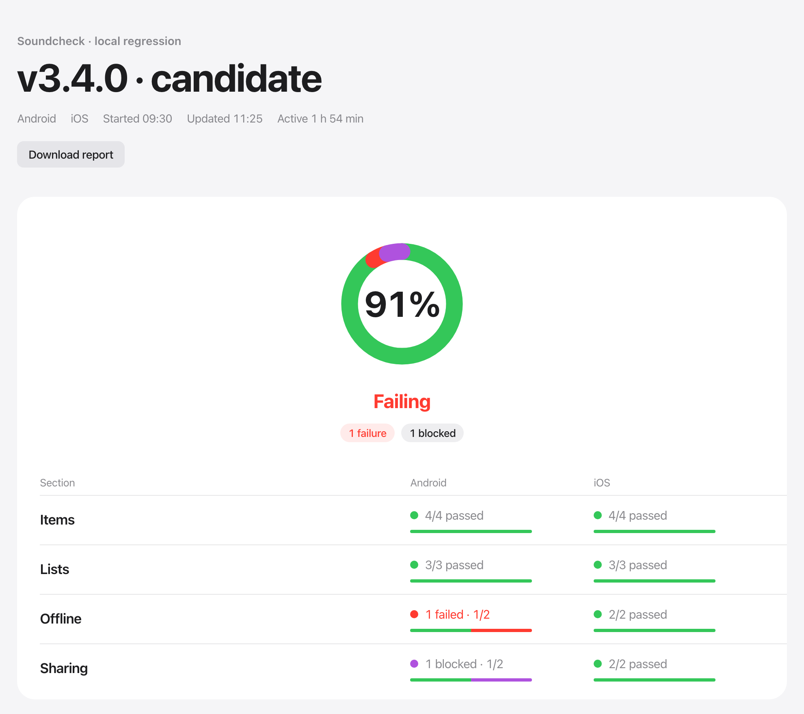
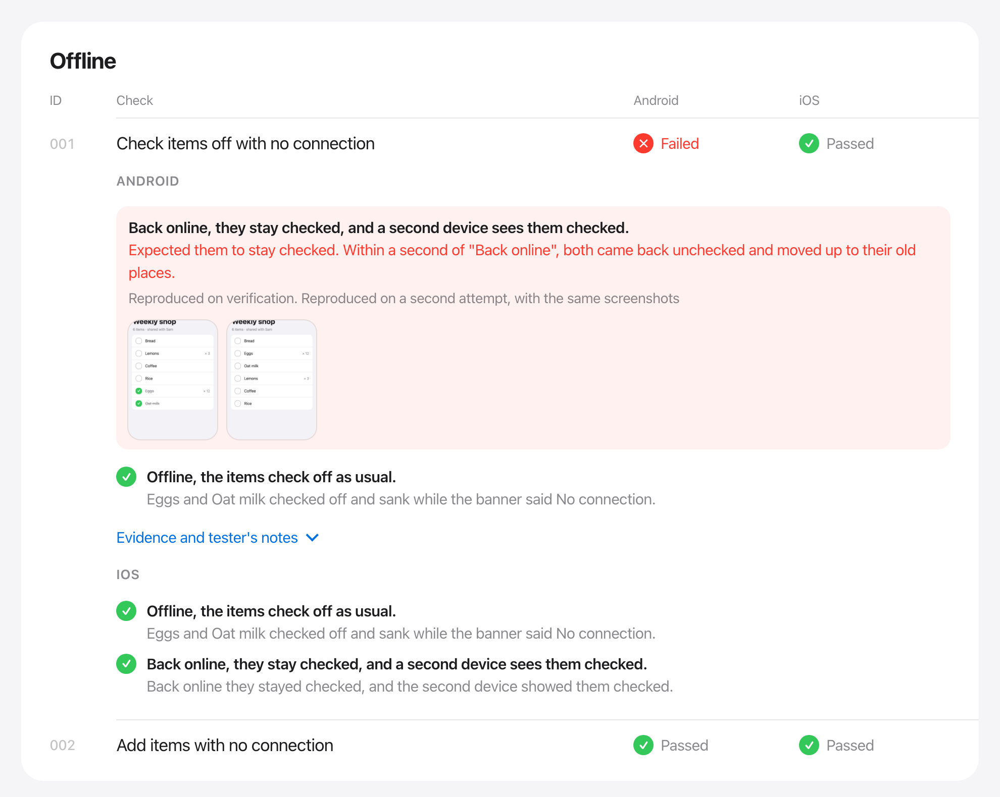
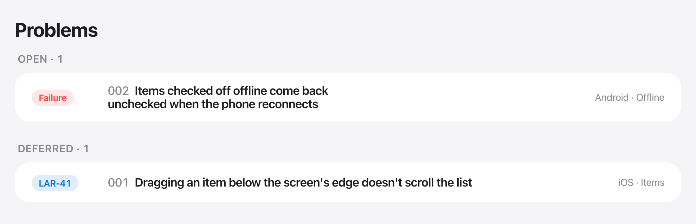

# Soundcheck

**Regression testing where AI agents are the testers.** You write what a user does and what should happen, in plain English. Soundcheck hands each spec to a Claude agent on a real Android emulator, iOS simulator or browser, has another agent check every claim it makes, and turns the run into one report you can act on.



<sub>A run of Larder, a made-up shopping list app (`docs/demo`). Every screenshot here is soundcheck's own report page.</sub>

## Why it's different

- **Specs read like a test plan, not code.** No selectors, no page objects, no waits. A spec says what a user does and the outcomes to judge, and it keeps working when the screens are redesigned.
- **Testers use the app the way people do.** They read the screen as a screen reader gets it, tap labelled controls, type, drag and go offline at a person's pace. A control with no label is a finding, not a flaky test.
- **Every claim is checked.** A tester says what it saw for each outcome. A reviewer agent, fresh for each one, checks each failure or doubt as it lands. It can uphold it, have it reproduced on a fresh attempt, send it back, or put it down to the harness. Nothing reaches the report on one agent's say-so.
- **Runs go unattended.** Start a run, go and do something else. The server starts each spec, launches its tester and has its claims reviewed by itself; the live page updates as each result lands, and a degraded device is restarted between specs. A run survives a server restart and carries on from its journal.
- **It ends in decisions, not logs.** Problems come with their evidence and a plain-words title. You triage them with the coordinator: fix, defer, dismiss or duplicate, linked to your tracker.

## Specs in plain words

A spec is one Markdown file:

```markdown
---
title: Check items off with no connection
platforms: [android, ios]
prepare:
  - node scripts/seed.js kitchen
  - node scripts/sign-in.js
tools: [offline]
---

## Goal

Take the app offline, check off `Eggs` and `Oat milk`, then bring it back online.

## Outcomes

- Offline, the items check off as usual.
- Back online, they stay checked, and a second device sees them checked.
```

Every spec starts on a fresh relaunch, then its `prepare` steps (the project's own scripts: seed the account, sign in, open a deep link) put the app where the tester begins, and `soundcheck lint` catches a vague outcome or a missing tool before anything runs. Optional sections pin exact steps (`## Pinned`) or ask the tester to probe around the goal (`## Probe around it`), which is where new bugs turn up beside old ones.

## A suite

A folder of specs, one subfolder per feature, and a `suite.yaml` that says how each platform gets the app running:

```yaml
soundcheck: "0.4"
platforms:
  android:
    driver: android
    device: Pixel_Tablet_API_35 # an AVD; booted headless if it isn't running
    app: com.example.larder
    hooks:
      guard: node hooks/guard.mjs android # refuses anything but a local backend
      build-identity: node hooks/build.mjs identity android
      install: node hooks/build.mjs install android
      check: node hooks/data.mjs check android
      stack-up: node hooks/stack.mjs up android
      stack-down: node hooks/stack.mjs down android
    proxy:
      - { name: api, listen: 33000, device: 23000, upstream: 42000 }
  chrome:
    driver: chrome
    device: desktop
    url: http://localhost:43173/app
    viewport: 1440x900
    hooks:
      # …the same hooks for chrome, plus `serve` to serve its build
specs: suite
parallel: true # one spec at a time on each platform, the platforms side by side
tickets:
  url: https://example.atlassian.net/browse/{id}
```

Each platform block is the whole of how that platform runs: its device, its own hooks with the platform written into each command, and its own proxy routes, which `offline`, `network-drop` and `fault` act on. Nothing is shared from the top level. A spec's `platforms` name these blocks, and readying a spec (seeding, signing in) is its own `prepare`, never a hook. An optional `_suite.md` beside `suite.yaml` holds what every tester needs to know whatever its spec (the test accounts' names, say); it goes into every tester's brief. [DESIGN.md](DESIGN.md) (5.2, 5.3) has every key and hook; [plugin/MIGRATIONS.md](plugin/MIGRATIONS.md) moves a 0.2 suite across, which 0.3 refuses by name.

## Every failure comes with its evidence



The tester's own words, the screenshots it took and the reviewer's call sit together. This one was seen once, sent back to be reproduced on a fresh attempt, and only then filed as a failure.

## Triage, then a verdict



At the end the coordinator goes through the problems with you, one at a time. It says what failed, how sure it is and what it suggests, and records your decision. The verdict is **Ready** only when nothing is open. The report exports as a single offline HTML file, screenshots included, to share or attach to a release.

## How a run works

```
 you ──▶ coordinator ──▶ soundcheck server ──┬──▶ tester ────────▶ device
          (Claude)        dispatch · journal  │    (one per spec)    Android · iOS · Chrome
             ▲            live page           └──▶ reviewer
             │                 │                   (one per claim)
             └── when needed ──┘
```

- **The server** runs the suite. It starts each spec on each platform, launches its tester, files clean passes, launches a reviewer for every claim, and waits out a busy Mac or a restarting device. It holds all state in an append-only journal and serves MCP over local HTTP, the live page and the reports. Nothing lives only in an agent's memory, and the server never makes a judgment call itself.
- **Testers and reviewers** are headless Claude Code processes the server launches (`claude --print`), each with only its own tools and nothing of your project's settings, hooks or CLAUDE.md. They run on your Claude subscription, so `claude` must be on the PATH where the server runs.
- **The coordinator** is the Claude session you talk to. It starts the run, then waits on `soundcheck attention <run folder>`, which exits only when the run needs it: the run paused itself, a review nobody settled, a fix build installed or failed, a device that won't restart, every row filed. It can pause, rerun or add specs at any point (`queue`), and it triages the findings with you at the end. A fix build can be installed mid-run (`install_build`), and the rows it could affect rerun on it; asked for while a spec is running or waiting for review on that platform, the install is queued and starts by itself once that spec is settled. `soundcheck usage <run folder>` lists what each attempt and each reviewer cost and the run's total, and `--compare <other run folder>` sets two runs side by side.
- **Reviewers** each settle one row's claim and side finds from the evidence the tester posted and the server captured, knowing what the run is testing (`soundcheck run --about "<text>"`). They can read the project's files but change nothing. Their model is `models.reviewer` in suite.yaml.
- **Testers** are launched with their brief and drive the device through soundcheck's tools: `see`, `tap`, `fill`, `touch` (one finger along a path), `swipe`, `hold`, `offline`, `network-drop`, `fault`, `preview-compare`, `match` and more. They post one result with a judgment per outcome.
- **Drivers:**
  - **Android:** a persistent reader APK reads the screen and injects input in milliseconds.
  - **iOS:** a persistent simulator reader does the same.
  - **Chrome:** its own browser per platform, headless by default.
  - Devices run without windows. `soundcheck run --headed` is for watching: Chrome opens in a window, Simulator.app opens on the iOS device being driven, and the Android emulator shows its window when soundcheck restarts it (one already running stays as it is). Look only, since a click or resize can steer a test.
  - Evidence (screenshots, the screen tree, app errors) is captured on every failure.
- **Watch from anywhere.** `soundcheck run --remote` (or `serve --remote`) opens the live page through an ngrok tunnel behind Google sign-in, read-only, for the accounts in suite.yaml's `remote.allow`. It prints the URL; add it to a home screen to open it full screen. Needs `ngrok` with its authtoken set.
- **A blank backend per platform.** With `stack-up` and `stack-down` hooks, each run starts a fresh backend for every platform and removes it when the server stops, or on the next start after a crash (`soundcheck stack status|down` by hand).
- **Results belong to their build.** Every row records the build it ran on, so a pass on yesterday's build never stands in for today's.

The design, and the reasons behind each choice, are in [DESIGN.md](DESIGN.md).

## Try the demo

```sh
cargo run --example demo                 # writes a run of docs/demo/suite into docs/demo/reports
soundcheck serve docs/demo/suite --open latest
```

## Install

You need what each platform drives: Chrome for chrome platforms, the Android SDK (adb, an emulator on Android 14, API 34, or newer) for Android, Xcode for iOS. You also need Claude Code itself (`claude`) on the PATH of the machine that runs the server, since the server launches its testers and reviewers with it. Then, in Claude Code:

```
/plugin marketplace add aledgjones/soundcheck
/plugin install soundcheck@soundcheck
```

That's all on an Apple Silicon Mac. The plugin's `soundcheck` command downloads the release matching the plugin's version on first use (about 16 MB, into `~/.soundcheck/<version>`), and runs that from then on. A project can name the marketplace and enable the plugin in its committed `.claude/settings.json` (`extraKnownMarketplaces`, `enabledPlugins`), so teammates are offered it when they trust the folder; each still runs the install once.

The server finds the readers beside its binary, in a checkout's `readers/<platform>/build/`, or where `SOUNDCHECK_ANDROID_READER` and `SOUNDCHECK_IOS_READER` point. Each platform drives the device suite.yaml names: an AVD name on android, a simulator's name (or UDID, where runtimes share a name) on ios, booted if it's down. Each device's reader has its own port, so platforms on one driver run side by side.

### From source

For working on soundcheck itself. Also needs a Rust toolchain, JDK 17+ and Android build-tools 35 for the Android reader, and [XcodeGen](https://github.com/yonaskolb/XcodeGen) (`brew install xcodegen`) for the iOS reader, whose build compiles idb's simulator frameworks from source (about a minute, once).

```sh
cargo install --path crates/server     # puts `soundcheck` on your PATH
readers/android/build.sh               # the Android reader APK
readers/ios/build.sh                   # the iOS reader
```

To try a build in a project that pins a release, run `node /path/to/soundcheck/scripts/dev-plugin.mjs on` from the project: it points the plugin at this checkout and sets `SOUNDCHECK_DEV=1`, so the plugin runs the `soundcheck` on your PATH instead of downloading a release. Both go only into the project's `.claude/settings.local.json`; `off` returns to the pinned release (the plugin CLI doesn't fall back by itself, so the script adds it again). Start a new session after either. Moved the checkout? Reinstall: a source build finds its readers through the checkout path.

### Releasing

Bump the version in `Cargo.toml` and `plugin/.claude-plugin/plugin.json` together, commit and push, then `scripts/release.sh --publish`: it builds the tarball in `target/package/` and uploads it as the GitHub release `v<version>`, which the plugin at that version downloads. Without `--publish`, nothing leaves the Mac.

## Use

1. **Set a project up** with the plugin's `setup` skill. It writes `suite.yaml`, hook stubs, a draft regression skill for the project, and the permission rules that stop the coordinator's soundcheck tools and commands prompting. (Testers and reviewers are given their tools when the server launches them, so they never prompt.)
2. **Write specs** with `create-test`, then check them with `soundcheck lint <suite>`.
3. **Run:** the project's regression skill hands a scope to the plugin's `run` skill. That skill starts the server (`soundcheck run <suite> --scope <features or specs> --label "v1.2.3 · candidate" --about "<what the run is testing>"`), which opens the live page, serves MCP at `http://127.0.0.1:7357/mcp` and, once its checks pass, runs the suite by itself. `--about` is a sentence or two for the reviewers (the release's changes, the fix being checked). The plugin reaches the server through `soundcheck mcp`, a stdio bridge, so a Claude Code session started before the server needs no reconnect. The skill then runs `soundcheck attention <run folder>` in the background: it waits until the run needs the coordinator, prints why and exits, and running it again misses nothing. `soundcheck events <run folder> --once` prints a run's story so far, and `soundcheck ready <run folder> <platform>` says why a platform is held. To try specs on code not yet committed, add `--uncommitted`: every project hook gets `SOUNDCHECK_UNCOMMITTED=1`, so the build-identity hook may accept the build, and the run is marked a trial, not a regression result, and files no tickets.

To look at runs without one going, `soundcheck serve <suite> --open latest` opens the newest run's page, and the list of every run is at its root; nothing needs exporting first. An export (`report.html`, screenshots embedded) is for sharing.

Outside a run, `soundcheck drive <android|ios> <command>` runs one driver command (`see`, `tap`, `touch`, `wait`, `shot`…) from the suite folder, for exploring, reproducing a bug or setting up screenshots; the plugin's `drive` skill tells Claude how. `soundcheck drive <platform> network offline|online` and `network-drop <seconds>` take the app's network away through that platform's proxy (its `proxy` routes in `suite.yaml`: each route's `upstream` is a local port or a remote URL such as `https://api.revenuecat.com`, which the proxy reaches over TLS), which runs detached once started; `soundcheck proxy status|stop` manage it.

Runs are written beside the suite in `reports/<run>/`: the journal, a summary, evidence, each tester's and reviewer's whole conversation (`agents/`), and `report.html` once the run finishes. `/runs` on the server lists every run. A start that fails before testing anything (a check that doesn't pass, a build that won't install) shows why on the page and keeps its run: its id is printed before the checks, and `--open <id>` starts it again once the cause is fixed.

## Reference

What every key does. The reasons behind them are in [DESIGN.md](DESIGN.md) (5.2 to 5.6); `soundcheck lint` refuses a key that isn't here.

### `suite.yaml`

| Key          | Required | What it does                                                                                                 |
| ------------ | -------- | ------------------------------------------------------------------------------------------------------------ |
| `soundcheck` | yes      | The soundcheck version the suite is written for (`"0.4"`). A suite for another minor version is refused.     |
| `platforms`  | yes      | One block per platform, named by the project (`ios`, `android`, `chrome`…). Specs use these names.           |
| `specs`      |          | The folder holding the feature folders, relative to the suite. Default: the suite folder itself.             |
| `fixtures`   |          | Files testers can `push` onto a device. Default: `fixtures/` in the suite folder.                            |
| `reports`    |          | Where runs are written. Default: `reports/` beside the suite folder.                                         |
| `models`     |          | `default`: the testers' model (`sonnet`; a spec's `model` overrides it). `reviewer`: reviewers' (`opus`).    |
| `parallel`   |          | `true` runs one spec at a time on each platform, the platforms side by side. Default: one spec at a time.    |
| `tickets`    |          | `url`: a link with `{id}` in place of a ticket ID, for triage. Leave it out to keep findings in the report.  |
| `remote`     |          | `allow`: the Google accounts that may open the live page through `--remote`. Without it, `--remote` refuses. |

### A platform

| Key              | Drivers       | What it does                                                                                                                                        |
| ---------------- | ------------- | --------------------------------------------------------------------------------------------------------------------------------------------------- |
| `driver`         | all, required | What drives it: `ios`, `android` or `chrome`. Two platforms can share a driver.                                                                     |
| `device`         | all, required | What the app runs on: a simulator's name or UDID (`ios`), an AVD name or adb serial (`android`), `desktop` (`chrome`). Booted if it's down.         |
| `app`            | ios, android  | The app ID the driver launches.                                                                                                                     |
| `url`            | chrome        | Where a launch opens.                                                                                                                               |
| `viewport`       | chrome        | The window's size at every reset, `WIDTHxHEIGHT`, unless a spec sets its own.                                                                       |
| `chrome-profile` | chrome        | A Chrome profile signed in to Google by hand (`soundcheck chrome-profile`). Each run starts from a copy, since Google refuses an automated sign-in. |
| `hooks`          | all, required | The project's commands for this platform (below).                                                                                                   |
| `proxy`          | all           | Routes from the app to its services, which `offline`, `network-drop` and `fault` act on. Each route:                                                |
| ↳ `name`         |               | The service's name (`api`), for the report and `fault`.                                                                                             |
| ↳ `listen`       |               | The port the app's test build talks to on this machine. Unique across platforms.                                                                    |
| ↳ `device`       | android       | The port the app uses on the device, forwarded to `listen`. Default: `listen`.                                                                      |
| ↳ `upstream`     |               | What really serves it: a port on this machine, or a URL (`https://api.revenuecat.com`) the proxy reaches over TLS.                                  |

### Hooks

Shell commands, one set per platform, each naming its platform itself. Exit 0 for ok; JSON on stdout where data comes back. Every hook gets `SOUNDCHECK_BIN`, the run's own soundcheck executable, for any `soundcheck drive` it runs (never a bare `soundcheck` from the PATH, which can be another version), and `SOUNDCHECK_UNCOMMITTED=1` in a `--uncommitted` trial.

| Hook             | Required          | When soundcheck calls it                                                                                       | What it does and returns                                                                                                                    |
| ---------------- | ----------------- | -------------------------------------------------------------------------------------------------------------- | ------------------------------------------------------------------------------------------------------------------------------------------- |
| `guard`          | yes               | Run start, and before every spec's reset                                                                       | The safety check: refuses (non-zero, the reason on stderr) unless everything the run touches is a test environment.                         |
| `build-identity` | yes               | Run start, and after every install                                                                             | Says which build is installed: `{ "commit", "fingerprint", "version" }`, from the app facts it gets on stdin. Results belong to that build. |
| `install`        | yes               | Run start, when `build-identity` can't identify the build (always with `--install`); a mid-run `install_build` | Builds the app from the current tree and installs it. Skipped when the build is current.                                                    |
| `check`          | yes               | A tester calls `check-data <name> [args]`                                                                      | Reads the project's own data (a row in the database) and returns it as JSON evidence. Read-only.                                            |
| `act`            |                   | A tester calls `act <name> [args]`                                                                             | The other side acting while the tester watches: another user revokes access, a second device renames a score.                               |
| `serve`          |                   | Run start, and again after every install                                                                       | Keeps something the platform needs running until the server stops, such as the web build at `url`. Ok once it serves.                       |
| `stack-up`       | with `stack-down` | Run start, before the guard                                                                                    | Starts this platform's blank backend; returns once it answers.                                                                              |
| `stack-down`     | with `stack-up`   | When the run's server stops, or on the next start after a crash                                                | Removes that backend and its data. Must succeed when it's already gone.                                                                     |

### A spec

Front matter:

| Key                 | Required | What it does                                                                                                                                                                                                                       |
| ------------------- | -------- | ---------------------------------------------------------------------------------------------------------------------------------------------------------------------------------------------------------------------------------- |
| `title`             | yes      | What the user does, in plain words. The report's name for the spec.                                                                                                                                                                |
| `platforms`         | yes      | The platforms it runs on: names from `suite.yaml`.                                                                                                                                                                                 |
| `prepare`           |          | Commands run in order after the fresh relaunch: seed data, sign in, open a deep link. A step is one command for every platform, or a map of one per platform (`true` for none there). Earlier steps can hand values to later ones. |
| `tools`             |          | Driver tools beyond the basics that the spec needs (`offline`, `double-tap`, `match`…). Lint checks they exist and that network tools have routes.                                                                                 |
| `model`             |          | A tester model for this spec, in place of the suite's (a stronger one for visual judgement).                                                                                                                                       |
| `viewport`          |          | Chrome only: this spec's window size, for a layout only a wide or a narrow window has.                                                                                                                                             |
| `keyboard`          |          | `software` for a spec that needs the on-screen keyboard. Default: a hardware keyboard, so typing is fast.                                                                                                                          |
| `past-bugs`         |          | Record only: the tickets this spec guards against.                                                                                                                                                                                 |
| `proven-failing-on` |          | Record only: the builds the spec was seen failing on before the fix, proving it catches the bug.                                                                                                                                   |

Sections:

| Section              | Required | What it does                                                                          |
| -------------------- | -------- | ------------------------------------------------------------------------------------- |
| `## Goal`            | yes      | What the tester does, from where `prepare` leaves the app.                            |
| `## Outcomes`        | yes      | `- ` bullets, each judged on its own: what should be true afterwards.                 |
| `## Pinned`          |          | Exact steps, only where they guard a past bug or reach a control an agent can't find. |
| `## Probe around it` |          | Where to look beyond the goal; the tester reports what it tried.                      |

A line in any section that starts with a platform tag (`[chrome]`, `- [android, ios]`) reaches only those platforms' testers.

## Develop

```sh
cargo test                  # chrome tests skip where Chrome isn't there; emulator and simulator tests never run
SOUNDCHECK_DEVICE_TESTS=1 cargo test   # also drive the running emulator and booted simulator (never during a run)
cargo clippy --all-targets -- -D warnings
cargo fmt
```

The run page is a Preact app in `crates/server/report-app`. Its bundle, `crates/server/src/report/app.js`, is checked in so building soundcheck needs no Node; after changing the app, run `npm install` once there, then `npm run build`, `npm run check` (types, and that the bundle matches its source) and `npm test`.

`cargo run --example demo` regenerates the README's demo run; its mock app screens are `docs/demo/mock/*.html`, rendered into `docs/demo/evidence/` with headless Chrome.
