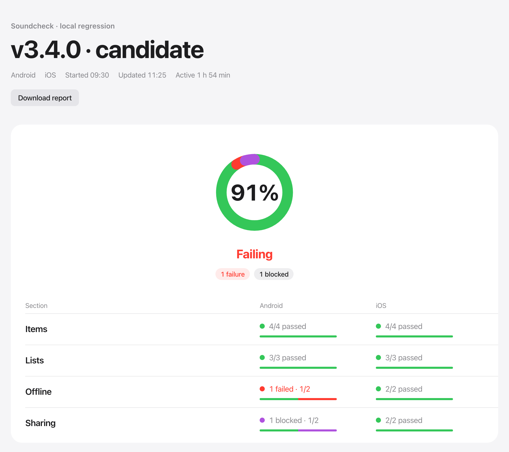
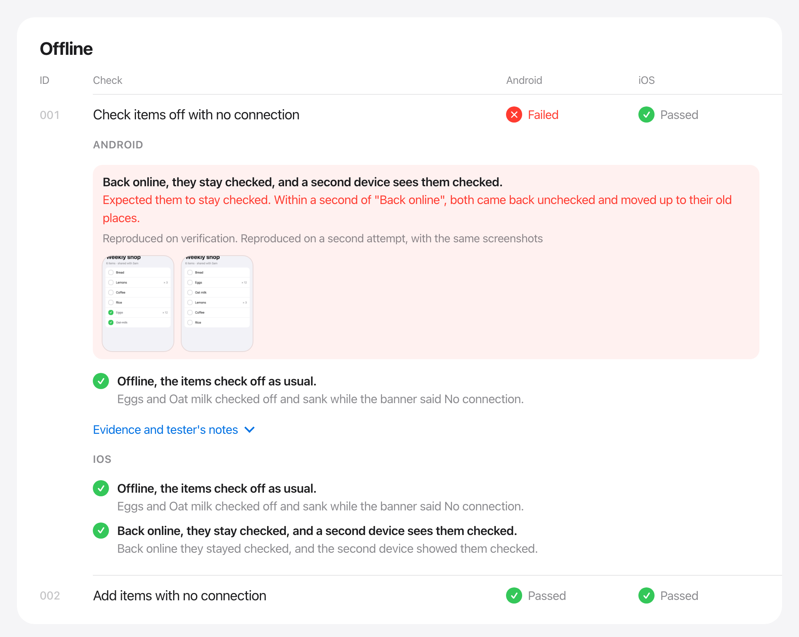
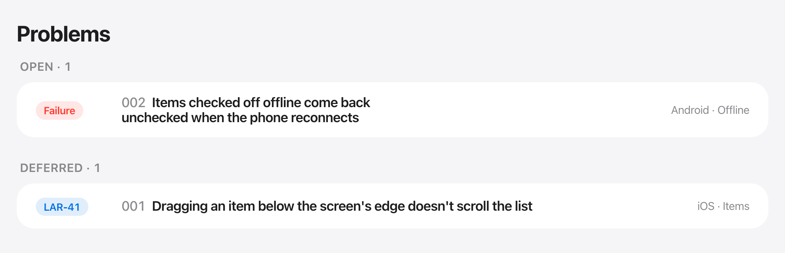

# Soundcheck

**Regression testing where AI agents are the testers.** You write what a user does and what should happen, in plain English. Soundcheck hands each spec to a Claude agent on a real Android emulator, iOS simulator or browser, has another agent check every claim it makes, and turns the run into one report you can act on.



<sub>A run of Larder, a made-up shopping list app (`docs/demo`). Every screenshot here is soundcheck's own report page.</sub>

## Why it's different

- **Specs read like a test plan, not code.** No selectors, no page objects, no waits. A spec says what a user does and the outcomes to judge, and it keeps working when the screens are redesigned.
- **Testers use the app the way people do.** They read the screen as a screen reader gets it, tap labelled controls, type, drag and go offline at a person's pace. A control with no label is a finding, not a flaky test.
- **Every claim is checked.** A tester says what it saw for each outcome. A coordinator agent reviews each failure or doubt as it lands. It can uphold it, have it reproduced on a fresh attempt, send it back, or put it down to the harness. Nothing reaches the report on one agent's say-so.
- **Runs go unattended.** Start a run, go and do something else. The live page updates as each result lands, and a degraded device is restarted between specs. A run survives a server restart and carries on from its journal.
- **It ends in decisions, not logs.** Problems come with their evidence and a plain-words title. You triage them with the coordinator: fix, defer, dismiss or duplicate, linked to your tracker.

## Specs in plain words

A spec is one Markdown file:

```markdown
---
title: Check items off with no connection
platforms: [android, ios]
prepare:
  - node scripts/seed.js kitchen
  - node scripts/sign-in.js
tools: [offline]
---

## Goal

Take the app offline, check off `Eggs` and `Oat milk`, then bring it back online.

## Outcomes

- Offline, the items check off as usual.
- Back online, they stay checked, and a second device sees them checked.
```

Every spec starts on a fresh relaunch, then its `prepare` steps (the project's own scripts: seed the account, sign in, open a deep link) put the app where the tester begins, and `soundcheck lint` catches a vague outcome or a missing tool before anything runs. Optional sections pin exact steps (`## Pinned`) or ask the tester to probe around the goal (`## Probe around it`), which is where new bugs turn up beside old ones.

## Every failure comes with its evidence



The tester's own words, the screenshots it took and the coordinator's call sit together. This one was seen once, sent back to be reproduced on a fresh attempt, and only then filed as a failure.

## Triage, then a verdict



At the end the coordinator goes through the problems with you, one at a time. It says what failed, how sure it is and what it suggests, and records your decision. The verdict is **Ready** only when nothing is open. The report exports as a single offline HTML file, screenshots included, to share or attach to a release.

## How a run works

```
 you ──▶ coordinator ──▶ soundcheck server ──▶ tester agent ──▶ device
          (Claude)         journal · live page    (one per spec)    Android · iOS · Chrome
            ▲                      │
            └── reviews each claim ┘
```

- **The server** holds all state in an append-only journal and serves MCP over local HTTP, the live page and the reports. Nothing lives only in an agent's memory.
- **The coordinator** dispatches one background tester per spec, reviews results while the next spec runs, and can pause, rerun or add specs at any point (`queue`). A fix build can be installed mid-run, and the rows it could affect rerun on it.
- **Testers** fetch their brief from the server and drive the device through soundcheck's tools: `see`, `tap`, `fill`, `touch` (one finger along a path), `swipe`, `hold`, `offline`, `network-drop`, `fault`, `preview-compare`, `match` and more. They post one result with a judgment per outcome.
- **Drivers:**
  - **Android:** a persistent reader APK reads the screen and injects input in milliseconds.
  - **iOS:** a persistent simulator reader does the same.
  - **Chrome:** its own browser per platform, headless by default.
  - Devices run without windows. `soundcheck run --headed` is for watching: Chrome opens in a window, Simulator.app opens on the iOS device being driven, and the Android emulator shows its window when soundcheck restarts it (one already running stays as it is). Look only, since a click or resize can steer a test.
  - Evidence (screenshots, the screen tree, app errors) is captured on every failure.
- **Watch from anywhere.** `soundcheck run --remote` (or `serve --remote`) opens the live page through an ngrok tunnel behind Google sign-in, read-only, for the accounts in suite.yaml's `remote.allow`. It prints the URL; add it to a home screen to open it full screen. Needs `ngrok` with its authtoken set.
- **A blank backend per platform.** With `stack-up` and `stack-down` hooks, each run starts a fresh backend for every platform and removes it when the server stops, or on the next start after a crash (`soundcheck stack status|down` by hand).
- **Results belong to their build.** Every row records the build it ran on, so a pass on yesterday's build never stands in for today's.

The design, and the reasons behind each choice, are in [DESIGN.md](DESIGN.md).

## Try the demo

```sh
cargo run --example demo                 # writes a run of docs/demo/suite into docs/demo/reports
soundcheck serve docs/demo/suite --open latest
```

## Install

You need what each platform drives: Chrome for chrome platforms, the Android SDK (adb, an emulator on Android 14, API 34, or newer) for Android, Xcode for iOS. Then, in Claude Code:

```
/plugin marketplace add aledgjones/soundcheck
/plugin install soundcheck@soundcheck
```

That's all on an Apple Silicon Mac. The plugin's `soundcheck` command downloads the release matching the plugin's version on first use (about 16 MB, into `~/.soundcheck/<version>`), and runs that from then on. A project can name the marketplace and enable the plugin in its committed `.claude/settings.json` (`extraKnownMarketplaces`, `enabledPlugins`), so teammates are offered it when they trust the folder; each still runs the install once.

The server finds the readers beside its binary, in a checkout's `readers/<platform>/build/`, or where `SOUNDCHECK_ANDROID_READER` and `SOUNDCHECK_IOS_READER` point. Each platform drives the device suite.yaml names: an AVD name on android, a simulator's name (or UDID, where runtimes share a name) on ios, booted if it's down. Each device's reader has its own port, so platforms on one driver run side by side.

### From source

For working on soundcheck itself. Also needs a Rust toolchain, JDK 17+ and Android build-tools 35 for the Android reader, and [XcodeGen](https://github.com/yonaskolb/XcodeGen) (`brew install xcodegen`) for the iOS reader, whose build compiles idb's simulator frameworks from source (about a minute, once).

```sh
cargo install --path crates/server     # puts `soundcheck` on your PATH
readers/android/build.sh               # the Android reader APK
readers/ios/build.sh                   # the iOS reader
```

To try a build in a project that pins a release, run `node /path/to/soundcheck/scripts/dev-plugin.mjs on` from the project: it points the plugin at this checkout and sets `SOUNDCHECK_DEV=1`, so the plugin runs the `soundcheck` on your PATH instead of downloading a release. Both go only into the project's `.claude/settings.local.json`; `off` returns to the pinned release (the plugin CLI doesn't fall back by itself, so the script adds it again). Start a new session after either. Moved the checkout? Reinstall: a source build finds its readers through the checkout path.

### Releasing

Bump the version in `Cargo.toml` and `plugin/.claude-plugin/plugin.json` together, commit and push, then `scripts/release.sh --publish`: it builds the tarball in `target/package/` and uploads it as the GitHub release `v<version>`, which the plugin at that version downloads. Without `--publish`, nothing leaves the Mac.

## Use

1. **Set a project up** with the plugin's `setup` skill. It writes `suite.yaml`, hook stubs, a draft regression skill for the project, and the permission rules that stop background testers and soundcheck's commands prompting.
2. **Write specs** with `create-test`, then check them with `soundcheck lint <suite>`.
3. **Run:** the project's regression skill hands a scope to the plugin's `run` skill. That skill starts the server (`soundcheck run <suite> --scope <features or specs> --label "v1.2.3 · candidate"`), which opens the live page and serves MCP at `http://127.0.0.1:7357/mcp`. The plugin reaches it through `soundcheck mcp`, a stdio bridge, so a Claude Code session started before the server needs no reconnect. To try specs on code not yet committed, add `--uncommitted`: every project hook gets `SOUNDCHECK_UNCOMMITTED=1`, so the build-identity hook may accept the build, and the run is marked a trial, not a regression result, and files no tickets.

To look at runs without one going, `soundcheck serve <suite> --open latest` opens the newest run's page, and the list of every run is at its root; nothing needs exporting first. An export (`report.html`, screenshots embedded) is for sharing.

Outside a run, `soundcheck drive <android|ios> <command>` runs one driver command (`see`, `tap`, `touch`, `wait`, `shot`…) from the suite folder, for exploring, reproducing a bug or setting up screenshots; the plugin's `drive` skill tells Claude how. `soundcheck drive <platform> network offline|online` and `network-drop <seconds>` take the app's network away through the suite's proxy (`network` in `suite.yaml`: each route's `upstream` is a local port or a remote URL such as `https://api.revenuecat.com`, which the proxy reaches over TLS), which runs detached once started; `soundcheck proxy status|stop` manage it.

Runs are written beside the suite in `reports/<run>/`: the journal, a summary, evidence, and `report.html` once the run finishes. `/runs` on the server lists every run. A start that fails before testing anything (a check that doesn't pass, a build that won't install) shows why on the page, then leaves no run behind.

## Develop

```sh
cargo test                  # chrome tests skip where Chrome isn't there; emulator and simulator tests never run
SOUNDCHECK_DEVICE_TESTS=1 cargo test   # also drive the running emulator and booted simulator (never during a run)
cargo clippy --all-targets -- -D warnings
cargo fmt
```

The run page is a Preact app in `crates/server/report-app`. Its bundle, `crates/server/src/report/app.js`, is checked in so building soundcheck needs no Node; after changing the app, run `npm install` once there, then `npm run build`, `npm run check` (types, and that the bundle matches its source) and `npm test`.

`cargo run --example demo` regenerates the README's demo run; its mock app screens are `docs/demo/mock/*.html`, rendered into `docs/demo/evidence/` with headless Chrome.
